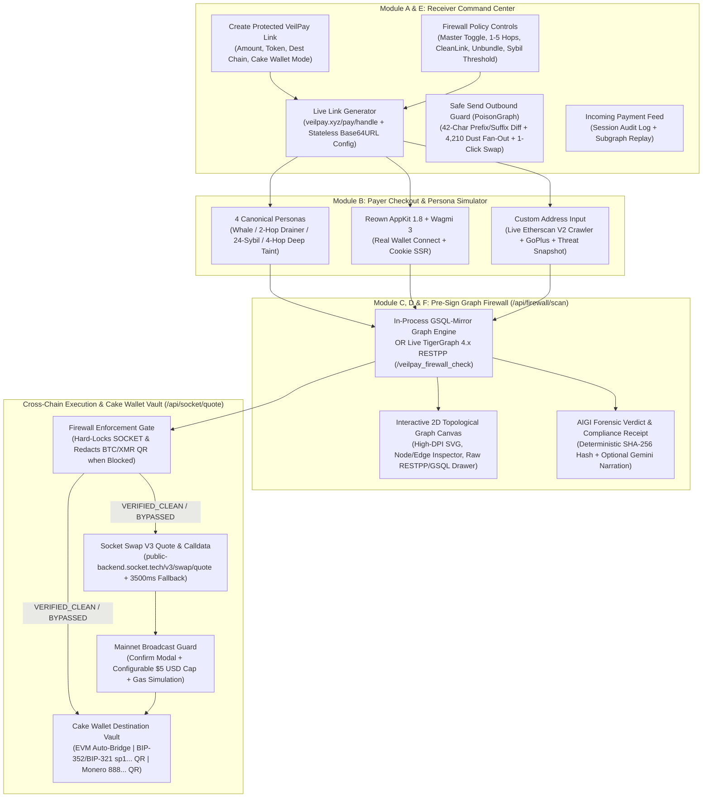

# VeilPay — End-to-End Implementation Plan (`IMPLEMENTATION_PLAN.md`)

> **Project:** VeilPay — Zero-Doxx Cross-Chain Payment Link & Pre-Sign Graph Firewall  
> **Event:** Hacker House Goa  
> **Core Sponsors Integrated:** TigerGraph (`3-in-1 Pre-Flight Graph Firewall`) · AIGI (`Deterministic Forensic Security Agent & SHA-256 Receipt`) · SOCKET (`Swap V3 Cross-Chain Engine`) · Cake Wallet (`Default Multi-Chain EVM + BIP-352 BTC Silent Payments + Monero RingCT Subaddress Vault`)

---

## 1. Architecture & System Flow Diagram



---

## 2. Target Repository Directory & File Structure

```text
hhgoa/
├── AGENTS.md                                  # Master context for AI agents (mirrored in CLAUDE.md)
├── CLAUDE.md                                  # Mirror of AGENTS.md
├── IMPLEMENTATION_PLAN.md                     # This persistent workspace implementation plan
├── README.md                                  # Setup, Reown Project ID guide, env vars, Vercel deploy guide
├── vercel.json                                # Vercel deployment & function timeout configuration
├── package.json                               # Next.js 16.4, React 19, Tailwind v4, Reown AppKit 1.8, Wagmi 3, Viem 2, Vitest
├── tsconfig.json                              # Strict TypeScript config
├── vitest.config.ts                           # Unit & edge-case test runner config
├── next.config.ts                             # Next.js 16 config (pino-pretty, lokijs, encoding externals for Reown SSR)
├── .env.example                               # Documented template for all optional/required env vars
├── .agents/skills/appkit/                     # Installed Reown AppKit skill & Next.js Wagmi references
├── docs/
│   ├── ARCHITECTURE_AND_DECISIONS.md          # 16 ADRs & exhaustive trade-off matrix
│   ├── API_AND_PROTOCOL_SPECS.md              # Verified 2026 API & URI specifications
│   ├── DESIGN_SYSTEM.md                       # Warm Carbon / Burnished Copper / Botanical Jade design system
│   ├── EDGE_CASES_AND_TEST_MATRIX.md          # Canonical EIP-55 personas & hop-depth 1-5 truth tables
│   └── reference/
│       └── socket-v3-quote-sample.json        # Real captured 50 KB Socket Swap V3 response fixture
├── tigergraph/
│   └── veilpay_firewall.gsql                  # Module F: Complete production GSQL schema & veilpay_firewall_check query
├── scripts/
│   └── refresh-threat-intel.mjs               # Script to refresh ScamSniffer + OFAC SDN threat snapshot
└── src/
    ├── data/
    │   └── threat-intel-snapshot.json         # Bundled ScamSniffer drainers + OFAC SDN + major exploits
    ├── types/
    │   └── veilpay.ts                         # Complete TypeScript interfaces for Graph, AIGI, SOCKET, PoisonGraph, Store
    ├── config/
    │   └── wagmi.ts                           # Reown AppKit + WagmiAdapter (ssr: true) + supported EVM networks
    ├── context/
    │   └── web3-provider.tsx                  # Client ContextProvider with cookieToInitialState & createAppKit
    ├── lib/
    │   ├── validators/
    │   │   └── address.ts                     # Strict EIP-55, BIP-352 Bech32m sp1..., Monero Base58 888..., & URI builders
    │   ├── graph/
    │   │   ├── seed-topologies.ts             # Canonical EIP-55 personas (1-5 hops, cycles, 24-sybil ring, 4,210 dust edges)
    │   │   ├── engine.ts                      # Real cycle-safe BFS/DFS GSQL-mirror traversal engine (CleanLink + Unbundle)
    │   │   ├── poison-guard.ts                # PoisonGraph prefix/suffix character-diff & dust-factory out-degree analyzer
    │   │   ├── tigergraph-client.ts           # Live TigerGraph 4.x RESTPP adapter (/gsql/v1/tokens & /restpp/query)
    │   │   └── live-crawler.ts                # Etherscan V2 multichain BFS crawler + GoPlus API + threat snapshot tagger
    │   ├── aigi/
    │   │   └── verdict.ts                     # Deterministic AIGI Forensic Verdict, SHA-256 commitment, & optional Gemini narrator
    │   ├── socket/
    │   │   ├── tokens.ts                      # Chain & token registry (ETH, ARB, BASE, OP, POL; USDC, USDT, ETH)
    │   │   └── client.ts                      # Socket Swap V3 client, V2/V3 dual-shape adapter, Same-Chain handler, 3500ms fallback
    │   ├── utils/
    │   │   └── link-codec.ts                  # Stateless Base64URL encoder/decoder for /pay/[handle]?c= shareable links
    │   └── __tests__/
    │       ├── engine.hop-depth.test.ts       # Tests hop boundaries 1..5 across Personas 1-4 & master toggle bypass
    │       ├── engine.cycles-and-sybil.test.ts# Tests cyclic wash loops, self-transfers, & 24-wallet sybil cluster collapse
    │       ├── poison-guard.test.ts           # Tests Case 4A (vanity clone diff), 4B (fresh recipient), 4C (malformed/wrong net)
    │       ├── aigi-determinism.test.ts       # Tests SHA-256 receipt determinism & zero-hallucination evidence chain
    │       └── uri-and-socket-adapter.test.ts # Tests BIP-321 sp1..., monero: URIs, & Socket V3 -> V2/V3 normalization
    ├── store/
    │   └── veilpay-store.ts                   # Shared Zustand store (Link Config, Active Scan, Payment Feed, Settings)
    ├── components/
    │   ├── TopTelemetryBar.tsx                # Institutional hardware header, live latency metrics, view switcher, Reown button
    │   ├── ReceiverSetupForm.tsx              # Module A: Amount, Asset, Cake Wallet 3-mode vault, 1-5 Hop Firewall controls, Link bar
    │   ├── PayerCheckoutPanel.tsx             # Module B: Persona Bar, Reown Wallet / Custom Address, Stepper, Settlement Gate
    │   ├── TopologicalGraphCanvas.tsx         # Module C: Interactive 2D SVG Graph, Sybil cluster collapse/expand, Node/Edge inspector, Raw GSQL/RESTPP drawer
    │   ├── AigiForensicReceiptCard.tsx        # Module D: Verdict badge, Hop-by-hop lineage, SHA-256 hash, JSON receipt export
    │   ├── SafeSendOutboundGuard.tsx          # Module E: PoisonGraph 42-char visual diff, dust fan-out visualizer, 1-click contact swap
    │   ├── IncomingPaymentFeed.tsx            # Session scan history table with 1-click subgraph & receipt replay
    │   ├── CakeWalletSettlementModal.tsx      # Spec-compliant QR generator (BIP-321 sp= & legacy bitcoin:sp1..., monero:, SOCKET Mainnet Guard)
    │   └── SettingsDrawer.tsx                 # Live Etherscan V2 crawl budget sliders & Mainnet USD safety cap controls
    └── app/
        ├── globals.css                        # Tailwind v4 @theme with Warm Carbon, Burnished Copper, Botanical Jade tokens
        ├── layout.tsx                         # Next.js 16 RootLayout with Plus Jakarta Sans, JetBrains Mono, SSR cookie hydration
        ├── page.tsx                           # Unified Split-Screen Command Center & Live Payer Checkout Simulator
        ├── pay/
        │   └── [handle]/
        │       └── page.tsx                   # Standalone shareable Payer Checkout route (/pay/[handle]?c=...)
        └── api/
            ├── firewall/
            │   ├── scan/route.ts              # POST/GET /api/firewall/scan (Hybrid GSQL Engine + Live TigerGraph + Live Crawler)
            │   └── poison/route.ts            # POST /api/firewall/poison (Outbound PoisonGraph lookalike & dust check)
            ├── aigi/
            │   └── verdict/route.ts           # POST /api/aigi/verdict (Deterministic AIGI receipt + optional Gemini summary)
            └── socket/
                └── quote/route.ts             # GET/POST /api/socket/quote (Firewall-gated Socket V3 quote + 3500ms fallback)
```

---

## 3. Phased Implementation Sequence

### Phase 1: Project Initialization & Design System Foundation
1. Initialize `package.json`, `tsconfig.json`, `next.config.ts`, `vitest.config.ts`, and `.env.example`.
2. Install verified dependencies:
   - Core: `next@^16.4.3`, `react@^19.1.0`, `react-dom@^19.1.0`
   - Styling & Icons: `tailwindcss@^4.3.3`, `@tailwindcss/postcss@^4.3.3`, `lucide-react`, `clsx`, `tailwind-merge`
   - Web3 & Wallet: `@reown/appkit@^1.8.24`, `@reown/appkit-adapter-wagmi@^1.8.24`, `wagmi@^3.7.9`, `viem@^2.57.13`, `@tanstack/react-query@^5.105.0`
   - State, Validation, QR & AI: `zustand@^5.0.16`, `zod@^4.6.7`, `qrcode@^1.5.4`, `@types/qrcode`, `@google/genai@^2.31.0`
   - Testing: `vitest@^5.0.5`, `typescript`
3. Configure `src/app/globals.css` with the Warm Carbon (`#0B0C0E`), Rich Graphite (`#131519`), Interactive Slate (`#1A1D23`), Hairline Border (`#262A33`), Burnished Copper (`#D97736`), Bullion Gold (`#E5A93C`), Botanical Jade (`#1F9D68`), Ochre Amber (`#D99B26`), and Oxide Vermilion (`#D6453A`) palette.

### Phase 2: Production TigerGraph GSQL Artifact & Core Graph Engine
1. Author `/tigergraph/veilpay_firewall.gsql` (Module F) with complete `VERTEX` definitions (`Wallet`, `Merchant`, `ThreatEntity`), `DIRECTED EDGE` definitions (`TRANSFERRED_TO` with `REVERSE_EDGE="REVERSE_TRANSFERRED_TO"`, `DUSTED`), and the `veilpay_firewall_check` multi-hop GSQL query using `OrAccum`, `MinAccum`, `SumAccum`, and `SetAccum`.
2. Implement `src/lib/validators/address.ts` for strict EIP-55 validation, Bech32m BIP-352 `sp1...` validation, Monero Base58 `888...` validation, and spec-compliant BIP-321 (`bitcoin:?sp=...`) / legacy `bitcoin:sp1...` / `monero:` URI builders.
3. Implement `src/lib/graph/seed-topologies.ts` with the 4 canonical EIP-55 personas, cyclic wash-ring edges, 24-wallet sybil cluster funded by `0xB055...9999`, and 4,210 outbound dust edges for the PoisonGraph clone.
4. Implement `src/lib/graph/engine.ts` (`runVeilPayFirewallTraversal`) with genuine BFS/DFS multi-hop backward traversal (`max_hops = 1..5`), cycle detection (`Set<string>` + `minHopByVertex`), `CleanLink` taint discovery, and `Unbundle` shared-ancestor sybil collapse.
5. Implement `src/lib/graph/poison-guard.ts` (`evaluateOutboundPoisonRisk`) with 42-character prefix/suffix/middle diffing, historical outbound interaction lookup, and dust-factory out-degree scoring.
6. Implement `src/lib/graph/tigergraph-client.ts` (live TigerGraph 4.x `/gsql/v1/tokens` & `/restpp/query` client) and `src/lib/graph/live-crawler.ts` (Etherscan V2 multichain crawler + bundled `threat-intel-snapshot.json` + live GoPlus security API).

### Phase 3: AIGI Forensic Agent & SOCKET Cross-Chain Adapter + API Routes
1. Implement `src/lib/aigi/verdict.ts` to produce the deterministic `AigiForensicReceipt` with hop-by-hop lineage narrative, canonical JSON serialization, Web Crypto `SHA-256` commitment hash, and optional Gemini structured executive summary.
2. Implement `src/lib/socket/tokens.ts` and `src/lib/socket/client.ts` to call `https://public-backend.socket.tech/v3/swap/quote` (or `dedicated-backend.socket.tech`), normalize V3 routes with V2 compatibility fields, handle Same-Chain direct transfers (`Scenario 5B`), and enforce the `3500ms` timeout with deterministic fallback (`Scenario 5C`).
3. Create Next.js App Router API routes:
   - `src/app/api/firewall/scan/route.ts`
   - `src/app/api/firewall/poison/route.ts`
   - `src/app/api/aigi/verdict/route.ts`
   - `src/app/api/socket/quote/route.ts` (enforces server-side firewall verification before returning route calldata).

### Phase 4: Institutional Terminal UI Components & Routes
1. Build Reown AppKit SSR context (`src/config/wagmi.ts`, `src/context/web3-provider.tsx`) and shared Zustand store (`src/store/veilpay-store.ts`).
2. Build `TopTelemetryBar.tsx`, `ReceiverSetupForm.tsx` (Module A), `PayerCheckoutPanel.tsx` (Module B), `TopologicalGraphCanvas.tsx` (Module C — interactive SVG topology + node/edge inspector + raw RESTPP/GSQL code view), `AigiForensicReceiptCard.tsx` (Module D), `SafeSendOutboundGuard.tsx` (Module E), `IncomingPaymentFeed.tsx`, `CakeWalletSettlementModal.tsx`, and `SettingsDrawer.tsx`.
3. Wire up `/` (`src/app/page.tsx`) and `/pay/[handle]` (`src/app/pay/[handle]/page.tsx`).

### Phase 5: Automated Verification Loop & Smoke Tests
1. Run zero-purple grep check across `src/`.
2. Run Vitest suite (`npm run test -- --run`) verifying all hop depths `1..5`, cycle detection, sybil collapse, PoisonGraph diff, SHA-256 determinism, and URI/SOCKET adapters.
3. Run `npx tsc --noEmit` and `npm run build` until zero errors.
4. Start dev server on port `3000` and smoke-test `/api/firewall/scan`, `/api/firewall/poison`, `/api/aigi/verdict`, and `/api/socket/quote`.
5. Initialize git repository with clean conventional commits.
